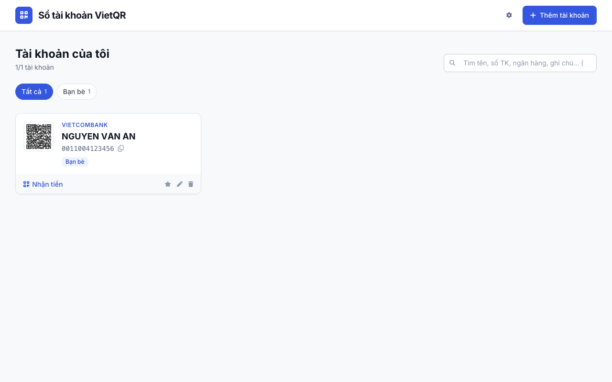

# Sổ tài khoản QR chuyển khoản — bản Tailwind (Vite)

Chrome extension quản lý số tài khoản ngân hàng và tạo mã VietQR để nhận chuyển khoản. Đây là bản giao diện Tailwind (font Inter, icon Font Awesome, màu xanh `blue-600`) build bằng Vite.



## Repo gồm hai nhánh

| Nhánh | Nội dung | Thư mục khi làm việc |
|---|---|---|
| `main` (nhánh này) | Bản Vite: giao diện, cấu hình build | `vietqr-account-manager-vite` |
| `plain` | Bản thường không cần build, chứa toàn bộ logic dùng chung (`src/`, `lib/`, `icons/`, `manifest.json`, Apps Script) | `vietqr-account-manager-extension` |

Bản Vite **không chạy một mình**: nó import logic từ thư mục anh em `../vietqr-account-manager-extension`. Vì vậy hai nhánh phải được clone vào hai thư mục nằm cạnh nhau, đúng tên như trên.

## Cài đặt

```bash
git clone -b main  https://github.com/qaqeqe0/vietqr-account-manager.git vietqr-account-manager-vite
git clone -b plain https://github.com/qaqeqe0/vietqr-account-manager.git vietqr-account-manager-extension
cd vietqr-account-manager-vite
npm install
npm run build
```

Sau đó mở `chrome://extensions`, bật **Developer mode**, bấm **Load unpacked** và chọn thư mục `dist`. Ghim extension lên thanh công cụ; phím tắt mở nhanh là `Alt+Shift+Q`.

## Lệnh

| Lệnh | Việc làm |
|---|---|
| `npm run dev` | Xem thử tại `http://localhost:5188/popup.html` (dữ liệu lưu ở localStorage) |
| `npm run build` | Tạo `dist/` để nạp vào Chrome |
| `npm run zip` | Build rồi đóng gói `vietqr-account-manager-vite.zip` |

Sửa logic ở thư mục `vietqr-account-manager-extension/src` thì chỉ cần build lại bản Vite.

## Tính năng chính

- Danh sách tài khoản có tìm kiếm không dấu, lọc theo nhóm, yêu thích và logo ngân hàng.
- Popup thu gọn dạng dòng có avatar; chế độ toàn tab dạng thẻ có ảnh thẻ VietQR thu nhỏ, mờ cho tới khi rê chuột.
- Mã VietQR tạo offline theo chuẩn NAPAS/EMVCo. Hộp thoại "Thẻ VietQR" có thể dùng ảnh thẻ chính thức từ img.vietqr.io (tự quay về thẻ vẽ offline khi mất mạng) và tải về dạng PNG.
- Ô số tiền hiểu `500k`, `1,5tr`, `2 triệu`; nội dung mặc định là tên người chuyển (in hoa) + "chuyen tien".
- Thêm tài khoản bằng cách quét mã QR (ảnh, camera, trang web, chuột phải), tự đọc tên chủ tài khoản (OCR trên máy, hoặc tra VietQR.io).
- Đồng bộ Google Sheet (qua Apps Script) và Google Drive; xuất/nhập file JSON.

Mô tả đầy đủ từng tính năng, quyền của extension và cấu trúc mã logic nằm trong README của nhánh [`plain`](https://github.com/qaqeqe0/vietqr-account-manager/tree/plain).

## Cấu trúc nhánh này

- `popup.html` — bố cục trang (thanh tìm kiếm, nhóm, danh sách, nút thêm nổi).
- `src/main.js` — điểm vào, nạp `popup-app.js` dùng chung.
- `src/ui-helpers.js`, `src/account-list-view.js` — thay thế phần hiển thị cùng tên của bản thường (hộp thoại, thông báo, icon, thẻ tài khoản).
- `src/account-row-compact.js` — dòng tài khoản thu gọn trong popup.
- `src/styles/app.css` — toàn bộ style Tailwind, kể cả dropdown, checkbox, thanh cuộn.
- `vite.config.js` — chuyển các import của bản thường sang file hiển thị ở đây, và chép `lib/`, `icons/`, `google-apps-script/`, `manifest.json` từ bản thường vào `dist/`.

## Hồ sơ Chrome Web Store

Thư mục `docs/store/` chứa hồ sơ đăng store: [chrome-web-store-listing.md](docs/store/chrome-web-store-listing.md) (mô tả, giải trình quyền, khai báo dữ liệu, ghi chú cho người duyệt), [privacy-policy.html](docs/store/privacy-policy.html), ảnh chụp 1280×800 trong `docs/store/screenshots/` và ảnh quảng bá `promo-tile-440x280.png` (dựng từ `promo-tile.html`).

## Lưu ý về dữ liệu

Bản Vite và bản thường là hai extension khác nhau trong Chrome nên có kho dữ liệu riêng. Để chuyển dữ liệu, dùng "Xuất file JSON" ở bản này rồi "Nhập file JSON" ở bản kia, hoặc bật cùng một Google Sheet để đồng bộ.
